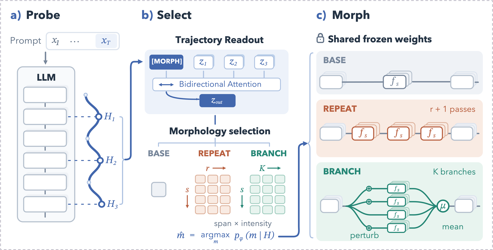

# Compute Has Shape: Self-Morphing the Internal Computation of Frozen LLMs

[](LICENSE)
[](https://www.python.org/downloads/)

SelfMorph decides the computational shape of a frozen LLM. The choice is one action in a shared morphology space:

- **BASE**: the original forward pass.
- **REPEAT**: extra serial passes through a selected layer span.
- **BRANCH**: parallel copies of a span, with scheduled perturbations, merged by averaging.

Inference is **Probe–Select–Morph**. Probing records the last-token hidden state at `L` layers. A lightweight selector reads that trajectory and picks one action before the first response token. The selected morphology then runs on the shared frozen weights. Truncated probing with prefix reuse, and lossless sharing of identical branch KV cache outside the branch span, are on by default.

The selector is trained by distilling a utility distribution. Utility is task score minus a cost penalty, `score - λ (C(m) - 1)`.

<p align="center">
  
</p>

```bash
python3 -m venv .venv
source .venv/bin/activate
pip install -U pip
pip install -e .
cp .env.example .env
```

Set `SELFMORPH_MODEL_PATH` before any step that loads a backbone.

## Preparation

Download each frozen backbone and set `SELFMORPH_MODEL_PATH` to its local directory or Hugging Face repo id. The matching runtime config and released selector are listed with the training commands below.

| Backbone | Weights |
| :--- | :--- |
| Qwen3.5-27B | [Qwen/Qwen3.5-27B](https://huggingface.co/Qwen/Qwen3.5-27B) |
| Qwen3.5-4B | [Qwen/Qwen3.5-4B](https://huggingface.co/Qwen/Qwen3.5-4B) |
| Gemma4-12B | [google/gemma-4-12B](https://huggingface.co/google/gemma-4-12B) |

Question files are not in this repository. Download them from the sources below and keep each dataset's own license. Place the diagnostic probes in `resources/datasets/` and the nine benchmarks in `resources/eval_datasets/`. Those two directories are gitignored. The BBH 3-shot templates in `resources/eval_protocols/bbh_cot_prompts/` are included. The templates come from [BIG-Bench Hard](https://github.com/suzgunmirac/BIG-Bench-Hard).

Span screening uses the fixed Math and EQ probes from [RYS](https://github.com/dnhkng/RYS) (`datasets/`):

The evaluated benchmarks use these sources and this local layout:

| Benchmark | Source | Local path |
| :--- | :--- | :--- |
| BBH, 19 subtasks | [lukaemon/bbh](https://huggingface.co/datasets/lukaemon/bbh) | `bbh_full/<subtask>/test-00000-of-00001.parquet` |
| ARC-Challenge | [allenai/ai2_arc](https://huggingface.co/datasets/allenai/ai2_arc), config `ARC-Challenge` | `arc_challenge/{train,test,validation}.parquet` |
| OpenBookQA | [allenai/openbookqa](https://huggingface.co/datasets/allenai/openbookqa) | `openbookqa/{train,test,validation}.parquet` |
| GSM8K | [openai/gsm8k](https://huggingface.co/datasets/openai/gsm8k), config `main` | `gsm8k/{train,test}.parquet` |
| MATH-500 | [HuggingFaceH4/MATH-500](https://huggingface.co/datasets/HuggingFaceH4/MATH-500) | `math500/test.parquet` |
| 2WikiMultiHopQA | [xanhho/2WikiMultihopQA](https://huggingface.co/datasets/xanhho/2WikiMultihopQA) | `twoWikiMultihop/validation.parquet` |
| HellaSwag | [Rowan/hellaswag](https://huggingface.co/datasets/Rowan/hellaswag) | `hellaswag/validation.parquet` |
| TruthfulQA-MC1 | [truthfulqa/truthful_qa](https://huggingface.co/datasets/truthfulqa/truthful_qa), config `multiple_choice` | `truthful_qa/multiple_choice/validation-00000-of-00001.parquet` |
| GPQA-Diamond | [idavidrein/gpqa](https://github.com/idavidrein/gpqa) | `gpqa_diamond/gpqa_diamond.csv` |

## Generate splits

After downloading the datasets, generate the train / validation / test manifests:

```bash
set -a; source .env; set +a
python scripts/generate_splits.py
```

This writes `resources/split_manifests/id_manifest.json` (in-distribution) and `ood_manifest.json` (unseen benchmarks). Pass `--seed <int>` to use a different random seed.

## Train

Collect the 25-action oracle, then distill the selector. Shard count is an argument, not a fixed machine size. One shard is enough to run the pipeline.

```bash
set -a; source .env; set +a

python scripts/collect_oracle.py \
    --config config/runtime.json \
    --datasets gsm8k \
    --output-dir artifacts/oracle \
    --shard-id 0 --num-shards 1 --device cuda:0

python scripts/build_training_data.py \
    --config config/runtime.json \
    --oracle-glob 'artifacts/oracle/shard*/oracle.jsonl' \
    --out-dir artifacts/training_data/qwen35_27b

python scripts/train_selector.py \
    --config config/runtime.json \
    --train-dev-pt artifacts/training_data/qwen35_27b/train_dev.pt \
    --output-dir artifacts/checkpoints/qwen35_27b
```

Use `config/runtime_qwen35_4b.json` or `config/runtime_gemma4_12b.json` for the other backbones. Released checkpoints are already at:

| Backbone | Config | Checkpoint |
| :--- | :--- | :--- |
| Qwen3.5-27B | `config/runtime.json` | `artifacts/checkpoints/qwen35_27b/best_checkpoint.pt` |
| Qwen3.5-4B | `config/runtime_qwen35_4b.json` | `artifacts/checkpoints/qwen35_4b/best_checkpoint.pt` |
| Gemma4-12B | `config/runtime_gemma4_12b.json` | `artifacts/checkpoints/gemma4_12b/best_checkpoint.pt` |

## Inference

`scripts/infer.py` loads one frozen backbone and its selector, then runs Probe–Select–Morph. Pass prompts directly, one prompt per line in a file, or a benchmark name. Each output row is JSON with the chosen action and the generated text.

```bash
python scripts/infer.py \
    --config config/runtime.json \
    --model-path Qwen/Qwen3.5-27B \
    --selector-checkpoint artifacts/checkpoints/qwen35_27b/best_checkpoint.pt \
    --text "What is 17 times 19?"

python scripts/infer.py \
    --config config/runtime.json \
    --dataset gsm8k \
    --limit 2 \
    --out artifacts/infer_gsm8k.jsonl
```

## Citation

```bibtex
@inproceedings{wu2026compute,
  title     = {Compute Has Shape: Self-Morphing the Internal Computation of Frozen LLMs},
  author    = {Wu, Junxi and Guo, Yiwen and Xia, Shu-Tao},
  booktitle = {arxiv},
  year      = {2026}
}
```
